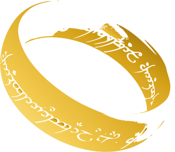

<div align="center">

# Mon Précieux : Projet OO Systems Development


Mon Précieux est une application Vue.js pour rechercher des films et construire sa bibliothèque personnelle :
films à voir, films vus et favoris, sauvegardés dans le navigateur.


Parcours principal : **Recherche -> Résultats -> Ajout -> Bibliothèque**.

</div>

## API utilisée : TMDB (The Movie Database)

L'application utilise l'[API TMDB](https://developer.themoviedb.org/docs) (v3), en français (`language=fr-FR`).

| Endpoint | Utilisation |
|---|---|
| `GET /search/movie` | Recherche par titre et autocomplétion |
| `GET /discover/movie?with_genres=` | Parcourir par genre |
| `GET /movie/{id}?append_to_response=credits` | Détail d'un film (avec le réalisateur) |
| `GET /movie/{id}/recommendations` | Section « Dans la même veine » |

Pour chaque film, l'application affiche le titre, le réalisateur, l'année et l'affiche.

## Installation

### 1. Récupérer une clé TMDB

Créer un compte sur https://www.themoviedb.org puis demander une clé dans
**Paramètres → API** (utiliser l'« API Key », pas le « Read Access Token »).

### 2. Créer le fichier `.env` à la racine du projet

```
VITE_API_KEY_TMDB=Votre_clé
VITE_USERS_KEY=cineclic-users
VITE_SESSION_KEY=cineclic-session
VITE_LIBRARY_KEY=cineclic-library
```

### 3. Lancer le projet

```
npm install
npm run dev
```

Application disponible sur `http://localhost:5173`

## Stack

- **Vue 3** (Vite)
- **Vue Router** : navigation entre les pages
- **Vuex** : comptes et bibliothèque
- **localStorage** : persistance des données
- **Figma** : maquettes et prototype

## Fonctionnalités

- **Recherche** par titre, avec autocomplétion à partir de 4 lettres
- **Parcourir par genre** : Drame, Policier, Comédie, Aventure, Science-Fiction, Romance
- **Détail d'un film** : genres, résumé, réalisateur, durée, pays, année et recommandations
- **Bibliothèque** : ajouter un film en « À voir » ou « Vu », changer son statut, le supprimer
- **Favoris** : ajouter ou retirer un film des favoris, page dédiée
- **Comptes** : création de compte et connexion, avec une bibliothèque séparée par compte
- **Persistance** : la bibliothèque reste disponible après un rechargement de la page
- **Responsive** : menu burger sur mobile

## Pages

| Route | Page |
|---|---|
| `/` | Recherche et genres |
| `/resultats?q=…` / `/resultats?genre=…` | Résultats d'une recherche ou d'un genre |
| `/detail/:id` | Détail d'un film, ajout à la bibliothèque et aux favoris |
| `/library` | Bibliothèque (filtres Tous / À voir / Vus / Favoris) |
| `/favorites` | Films favoris uniquement |
| `/connexion` | Connexion et création de compte |

## Store Vuex

Le store se trouve dans `src/store/index.js`.

- **state** : `users`, `currentUser`, `library`
- **getters** : `libraryCount`, `getFilm`, `favorites`, `toWatch`, `watched`
- **mutations** : `addFilm`, `removeFilm`, `setStatus`, `toggleFavorite`, `addUser`, `setCurrentUser`
- **actions** : `setFilmStatus`, `removeFilm`, `toggleFavorite`, `register`, `login`, `logout`

Un film de la bibliothèque a la forme suivante :

```js
{ id, title, year, poster, director, status: 'toWatch' | 'watched', favorite: true | false }
```

## localStorage

| Clé | Contenu |
|---|---|
| `cineclic-users` | Comptes (mots de passe stockés sous forme de hash SHA-256) |
| `cineclic-session` | Nom du compte connecté |
| `cineclic-library-<compte>` | Bibliothèque de chaque compte |

Les comptes sont stockés uniquement dans le navigateur. C'est adapté à un projet de cours, mais ce
n'est pas une vraie sécurité.

## Structure

```
src/
├── assets/          Image de fond
├── components/      NavBar, AppFooter, SearchBar, FilmCard
├── router/          Routes Vue Router
├── services/        Appels à l'API TMDB
├── store/           Store Vuex
└── views/           Recherche, Résultats, Détail, Bibliothèque, Connexion
```

## Figma

Prototype : https://www.figma.com/design/1hUiMPfeDv402sT5XZB65O/Projet-OO?node-id=0-1&t=QJ7QtWxUWJkwyQmy-1

## Auteurs

- Nicolas
- Henri
